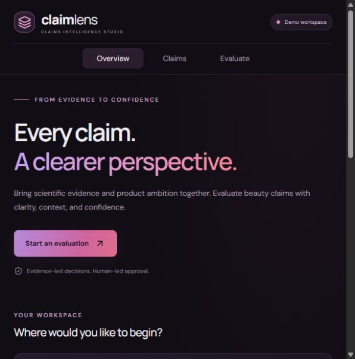
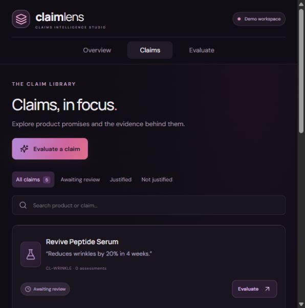
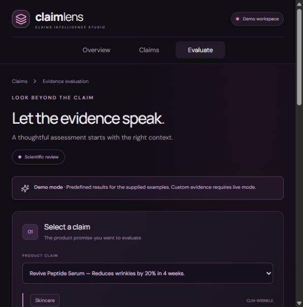
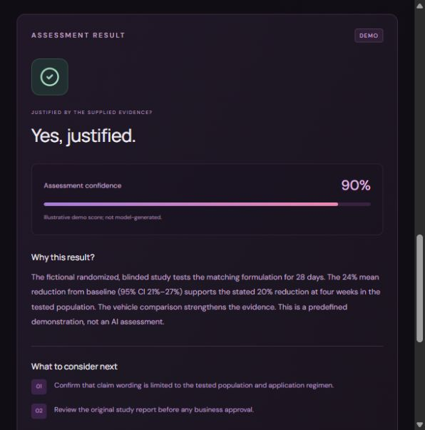

# ClaimLens

A complete local prototype for reviewing beauty product claims against study evidence. React runs on **3000**, NestJS on **3001**, and Prisma uses **real in-memory SQLite** through a singleton driver adapter. No database installation, Docker, or external database account is needed.

**Assessment modes:** demo runs without credentials; live uses OpenAI with a backend API key.

## UI screenshots

The original black, purple and pink interface, shown in labelled demo mode with fictional products and study data.

### Home



### Claims



### Evaluation



Example saved demo result:



## Run locally

1. Install **Node.js 22.12 or newer** (Node 24 LTS recommended) with npm.
2. Open a terminal in this folder, beside this README and the root `package.json`.
3. Install dependencies and start both applications:

```sh
npm install
npm run dev
```

Open **http://localhost:3000**. Both apps start together. First installation requires internet access. All application source, lockfile, and configuration are included; `node_modules` is downloaded for your operating system.

The default is **demo mode**, which runs immediately without API credentials. Five fictional claims and study summaries load automatically. Assessments disappear when the backend restarts, including a restart triggered by editing backend source.

Use Ctrl+C to stop both processes. Keep ports 3000 and 3001 free. Vite fails clearly rather than silently changing its port.

## Enable real OpenAI assessments

Copy `backend/.env.example` to `backend/.env`, then set:

```dotenv
ASSESSMENT_MODE=live
OPENAI_API_KEY=your_api_key_here
OPENAI_MODEL=gpt-4.1-mini
```

Restart the backend, refresh the browser, and verify the top-right indicator says **Live assessment**. The selected model must be available to your API project and support structured Chat Completions output. Live requests require internet access and API billing. The key stays on the backend and is never included in frontend code. Do not commit `.env`.

Demo mode is a deterministic fixture, **not an LLM**. Original example text returns predefined educational results. Edited/custom evidence returns **Not assessed** with no confidence value displayed. Results and history are visibly labelled by mode. Live errors never fall back silently to demo results.

## Pages and demo

- **Home `/`**: introduction, Claims and Evaluate cards, counts.
- **Claims `/claims`**: searchable library, assessment filters, latest result and evaluate action.
- **Evaluate `/evaluate?claimId=clm-wrinkle`**: choose claim, inspect formula context, edit evidence, run assessment, review verdict/confidence/reasoning/gaps, revisit history.

Suggested walkthrough: evaluate Revive Peptide Serum for a supported example, Aqua Veil for a missing 48-hour endpoint, and Bond Bloom for a laboratory-to-consumer wording mismatch. Revisit Claims to show saved statuses. Open assessment history to show traceability. Restart the backend to demonstrate fresh in-memory storage.

## Commands

```sh
npm run dev       # frontend + backend, watch mode
npm run build     # type-check and compile both applications
npm start         # compiled backend + frontend preview (run build first)
```

Separate terminals are also supported from the root:

```sh
npm run dev --prefix backend
npm run dev --prefix frontend
```

`npm install` generates Prisma Client automatically. After changing the Prisma schema, run `npm run prisma:generate --prefix backend` and update the memory initialization DDL in `backend/src/database.ts` to match. The DDL contains only fixed developer-authored SQL; user inputs are saved with Prisma's parameterized operations. `DATABASE_URL` in the example is for Prisma tooling, not the runtime database. Do not use `prisma migrate dev` to initialize the in-memory connection.

## API

| Method | Route | Purpose |
|---|---|---|
| GET | `/api/health` | Mode, model, storage, readiness |
| GET | `/api/claims` | Claims with latest assessment and counts |
| GET | `/api/claims/:id` | Claim and assessment history |
| POST | `/api/claims/assess` | Validate, assess, save, and return result |

Request:

```json
{
  "claimId": "clm-wrinkle",
  "claim": "Reduces wrinkles by 20% in 4 weeks.",
  "evidence": "Paste the selected claim's full example or a study summary here."
}
```

The supplied claim must match the saved wording. Evidence must contain 30–20,000 characters. Successful responses return 201 with `id`, `claimId`, `claimTextSnapshot`, `evidenceText`, `justified`, `confidenceScore` (0–100), `reasoning`, `evidenceGaps` (array), `model`, `promptVersion`, `mode`, and `createdAt`.

Error cases: 400 invalid/stale input; 404 unknown claim; 503 missing live key; 502 invalid/refused/failed model response. OpenAI errors do not create an assessment record. Default JSON request size is limited by Nest/Express. CORS permits the configured frontend origin; Vite proxies `/api` to localhost:3001.

## Structure

```text
claimlens/
  package.json              Installer and combined scripts
  package-lock.json         Root, backend, and frontend lockfiles
  backend/
    .env.example
    prisma/schema.prisma    Claim and Assessment models
    src/main.ts             Bootstrap, environment, CORS
    src/app.ts              NestJS controller and service
    src/database.ts         Singleton in-memory Prisma setup
    src/assessment.ts       Prompt, validated OpenAI output, demo fixtures
    src/seed.ts             Fictional claims and studies
  frontend/
    index.html
    vite.config.ts          Port 3000 and API proxy
    src/App.tsx             Three routes and view components
    src/api.ts              Typed API client and request errors
    src/types.ts            Shared frontend data contracts
    src/icons.ts            Only the SVG icons used by the app
    src/styles.css          Responsive dark purple/pink design
```

## Design decisions and limits

One Claim has many Assessments; each assessment stores immutable wording/evidence snapshots, mode, model and prompt version. Evidence gaps use JSON-encoded text in SQLite and are returned as an array. Confidence is subjective model confidence, not a probability of efficacy or a statistical confidence interval. “Not justified” includes insufficient evidence and does not establish that a claim is false. Human review is required.

The one-day scope deliberately omits authentication, file uploads, product CRUD, approval routing, rate limits, asynchronous jobs, and production monitoring. Local binding is 127.0.0.1. This demo is not a public deployment configuration. A future persistent database and migrations replace the memory initializer; maintainable service boundaries already separate HTTP, assessment and storage concerns.

The font stylesheet optionally loads Google Fonts; system sans-serif fallbacks keep the UI usable offline. All diagrams and UI decoration use CSS/SVG icons, with no required image downloads.

## Troubleshooting

- **Ports in use:** stop the old app using those ports; do not change ports unless also updating the proxy/origin configuration.
- **Prisma Client missing:** run `npm run prisma:generate --prefix backend`.
- **Native SQLite installation failure:** use a current Node LTS release and rerun `npm install`; better-sqlite3 normally provides binaries for supported platforms. If your platform needs a source build, follow its compiler prerequisites.
- **API unreachable:** check that the API terminal reports port 3001 and inspect `http://localhost:3001/api/health`.
- **Live mode fails:** check key, billing, selected-model access, and connection. No successful live assessment is claimed by this repository without your own configured key.
- **History disappears:** expected when the backend restarts; storage is intentionally in memory.

Test folders and Windows launcher scripts are excluded from this assessment repository. Deployment templates are not needed for local startup and are not included.

The backend pins Prisma 6 with tested SQLite driver 13, which bundles cross-platform prebuilds for modern Node versions. Overrides for two Prisma CLI dependencies apply available security fixes; regenerate and test when changing these pins.


## Assessment submission

See [the submission draft](Loreal-Assessment-Submission-Draft.md) for business understanding, research, architecture justification and roadmap.

Start locally with `npm install` and `npm run dev`. Deployment templates are not included in this assessment.
