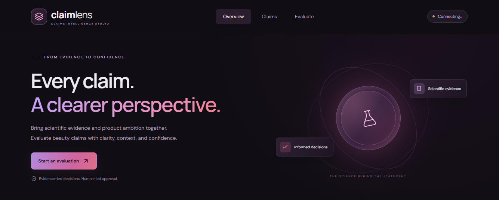
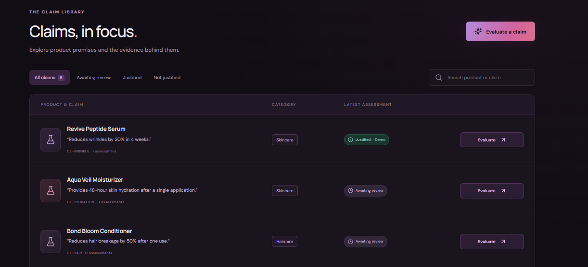
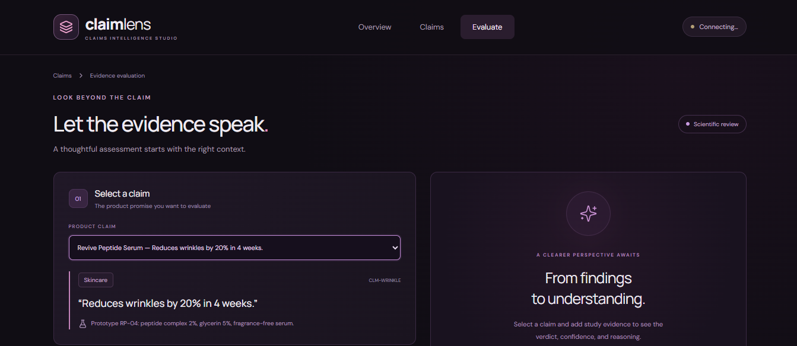
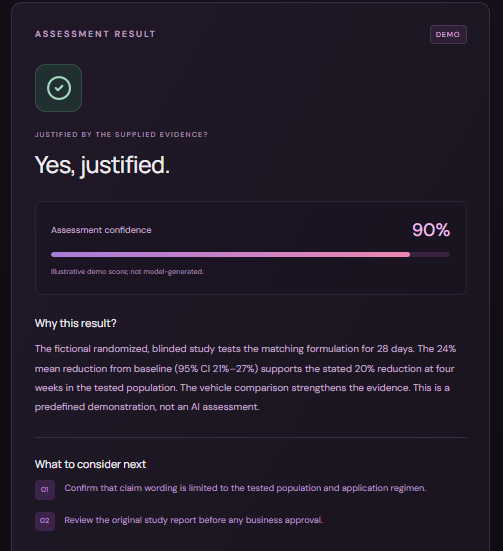

# ClaimLens

Evaluate beauty product claims against study evidence using **React, NestJS, Prisma and OpenAI**. SQLite runs in memory; no database server is needed.

## Run locally

Requires **Node.js 22.12+** and npm. From the repository root:

```sh
npm install
npm run dev
```

- **Frontend:** http://localhost:3000
- **API health:** http://localhost:3001/api/health
- **Stop:** Ctrl+C

Start through npm: `start-local.cmd` and other `.cmd` files are excluded from Git, along with test folders. Deployment files are not included.

## Assessment modes

**Demo (default):** no API key; predefined results for five fictional claims. Edited evidence is labelled **Not assessed**.

**Live:** copy `backend/.env.example` to `backend/.env`, set the following, then restart:

```dotenv
ASSESSMENT_MODE=live
OPENAI_API_KEY=your_api_key_here
OPENAI_MODEL=gpt-4.1-mini
```

Live mode needs model access and API billing. Keep `.env` private. Failed live calls do not fall back to demo results.

## Commands

```sh
npm run build   # Type-check and build both apps
npm start       # Run locally after building
```

Claim and assessment IDs are auto-incrementing integers. History and IDs reset when the backend restarts. Assessments support human review; confidence is not a clinical probability.

## Documentation

- [Assessment submission](docs/Loreal-Assessment-Submission-Draft.md)
- [Current implementation](docs/ClaimLens-Current-Implementation.md)

## Screenshots

Fictional products and evidence, shown in demo mode.

### Home



### Claims



### Evaluation




