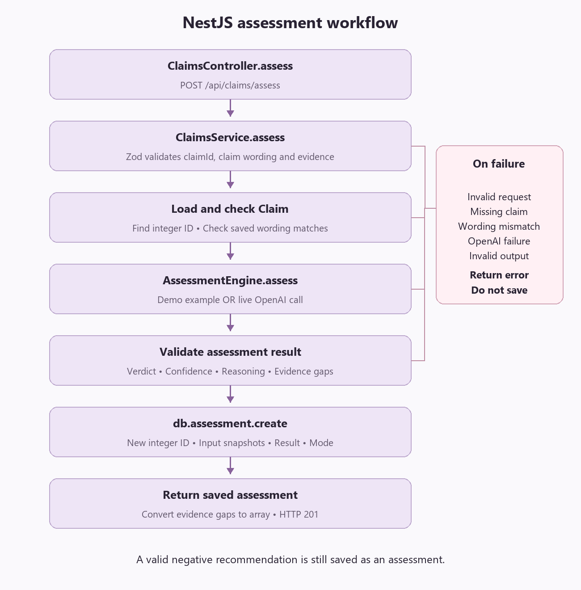

# ClaimLens current implementation

The executable implementation accompanies this proposal. The following excerpts summarize the three technical areas requested in the assignment; they are illustrative outlines, not replacements for the application source.

### Database relationship

```prisma
model Claim {
  id                 Int       @id @default(autoincrement())
  productName        String
  category           String
  claimText          String
  formulaDescription String
  evidence           String
  createdAt          DateTime     @default(now())
  updatedAt          DateTime     @updatedAt
  assessments        Assessment[]
}

model Assessment {
  id                Int   @id @default(autoincrement())
  claimId           Int
  claim             Claim    @relation(fields: [claimId], references: [id])
  claimTextSnapshot String
  evidenceText      String
  justified         Boolean
  confidenceScore   Int
  reasoning         String
  evidenceGaps      String
  model             String
  promptVersion     String
  mode              String
  createdAt         DateTime @default(now())

  @@index([claimId, createdAt])
}
```

Claim and Assessment IDs are auto-incrementing integers. Assessment.claimId references Claim.id. Each evaluation inserts a new assessment; IDs and history reset with the in-memory database.

The executable schema additionally specifies the SQLite datasource, Prisma generator, and relation deletion behavior. The prototype writes `evidenceGaps` as JSON text and exposes an array to clients.

### NestJS assessment workflow



The controller calls `ClaimsService.assess`. The service validates the request and saved claim, calls `AssessmentEngine.assess`, then saves a new record using `db.assessment.create`. Demo and valid live results are saved with their mode. Validation or OpenAI failures return an error without saving an assessment.

### React request and display

```jsx
async function handleAssessment() {
  try {
    setBusy(true);
    setError("");
    const saved = await api.assess(claim.id, claim.claimText, evidence);
    setResult(saved);
  } catch (error) {
    setError(error.message);
  } finally {
    setBusy(false);
  }
}

// Result display outline
{
  result && (
    <section>
      <p>Justified: {result.justified ? "Yes" : "No"}</p>
      <p>Confidence: {result.confidenceScore}%</p>
      <p>{result.reasoning}</p>
    </section>
  );
}
```

The application uses typed React components and additionally displays mode information, evidence gaps, saved history, loading/error states, and the confidence explanation.
