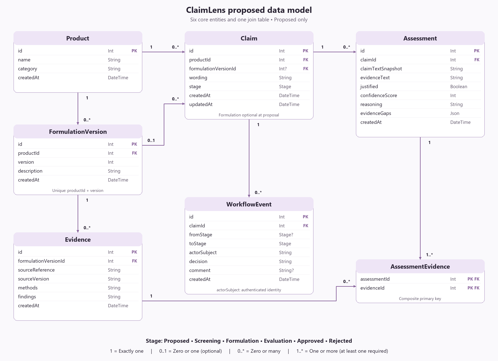
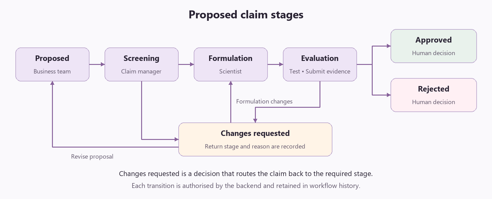

# ClaimLens future implementation

Proposed evolution across the product and claims workflow. Scientists develop and test formulations; evaluators test products against claims and submit evidence and reports. The current application supports assessment of submitted evidence only.

## Future model

Each table stores one type of information: products, formulation versions, claims, evaluation evidence, assessments or workflow history. AssessmentEvidence links assessments to the studies they use, allowing evidence to be reused without duplicating study records.

Evaluators submit Evidence against the tested formulation version. Assessment stores the subsequent comparison of that evidence with a claim.

PK means primary key; FK means foreign key; `?` means optional. Types use Prisma notation. AssessmentEvidence uses the assessmentId and evidenceId pair as its primary key.

## Claim stages

| Stage | Responsible stakeholder | Purpose |
| --- | --- | --- |
| Proposed | Business or marketing team | Define the product idea and intended claims. |
| Screening | Claim manager and research team | Check applicability, feasibility and similar existing work. |
| Formulation | Scientist | Develop and test the product formulation. |
| Evaluation | Evaluator | Test the product against claims and submit evidence and a report. |
| Approved or Rejected | Authorised reviewer | Record the final decision; confirm ownership and criteria with stakeholders. |

A request for changes returns work to the relevant stage. A human reviewer makes the final approval decision.

## AI vision

| Stage | Proposed assistance |
| --- | --- |
| Business proposal | Suggest measurable wording and find similar claims. |
| Research and screening | Retrieve relevant existing products and studies; flag feasibility questions and evidence needs. |
| Formulation | Help scientists find relevant formulation knowledge and summarise their formulation-test findings. |
| Product evaluation | Help evaluators organise submitted findings, identify missing information and draft evidence summaries. |
| Evidence assessment | Recommend justified or not justified, with confidence, reasoning and evidence gaps linked to submitted sources. Suggest narrower wording when needed. |
| Reporting | Draft reports combining evaluation evidence, assessment findings, limitations and review decisions. |

These are proposed capabilities. Responsible scientists, evaluators and business owners validate outputs and retain decision authority.
