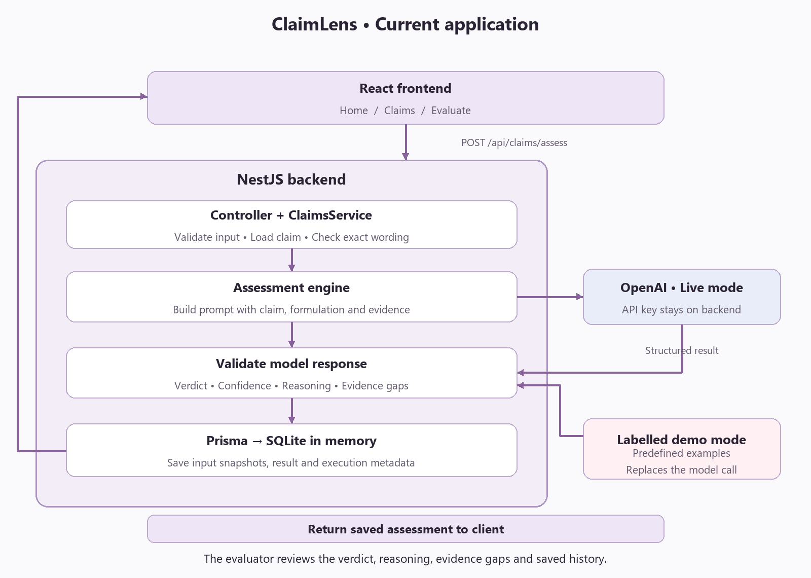

# ClaimLens technical proposal

### Executive summary

ClaimLens helps a claims evaluator determine whether supplied study evidence supports the semantics and exact wordings of a proposed product claim. The prototype provides a three-page React interface, a NestJS API, a Prisma data model, and an OpenAI assessment integration. Each completed assessment retains the claim wording, submitted evidence, result, and model context for later review.
The database runs in memory to simplify setup; data resets when the backend restarts.

The four sections below address the requested outputs: business process understanding, research performed, technical architecture justification, and a future product roadmap.

## 1. Business process understanding

### Business Requirement

A product claim expresses a specific promise. A scientist may produce evidence for a related benefit without substantiating every part of that promise. The evaluator needs to compare the wording with what was actually tested, identify gaps, and communicate an accountable decision.

For example, a study showing improved hydration at 24 hours does not establish a claim of 48-hour hydration. The system should explain the missing time point rather than produce a generic positive summary of the study.

### The business workflow

| Stage              | Primary stakeholder | Question to resolve                                        | Output                                                   |
| ------------------ | ------------------- | ---------------------------------------------------------- | -------------------------------------------------------- |
| Propose            | Business team       | What benefit do we want to communicate?                    | Proposed product and claim wording                       |
| Screen             | Claim manager       | Is the claim applicable and feasible to substantiate?      | Screening decision and evidence needs                    |
| Formulate and test | Scientist           | Which formulation and study can test the proposed benefit? | Formulation identity, methods, findings, and limitations |
| Evaluate           | Evaluator           | Does the evidence support the exact claim?                 | Assessment and recommendation for human review           |

The prototype implements the evaluation stage. The earlier stages provide context rather than complete role-based workflows. This keeps the ClaimLens focused on the required claim, evidence, LLM, database, and UI interaction.

## 2. Research performed and its effect on the design

Research focused on implementation requirements and evidence-review failure modes. Technology research used primary documentation; the prototype did not perform a clinical literature review or validate the scientific quality of any model against real product studies.

| Research area           | Finding                                                                                      | Consequence for this solution                                                                              |
| ----------------------- | -------------------------------------------------------------------------------------------- | ---------------------------------------------------------------------------------------------------------- |
| React UI layer          | Components separate presentation, while state tracks changing user input and request status. | Use Home, Claims, and Evaluate views with reusable components and clear loading, error, and result states. |
| NestJS request handling | Controllers and injectable providers separate HTTP handling from application behavior.       | Keep the controller small and place orchestration and model interaction behind service boundaries.         |
| Prisma and SQLite       | SQLite can be accessed through a Prisma driver adapter without a database server.            | Use a singleton in-memory connection for the requested local prototype.                                    |
| Structured model output | A JSON schema can constrain response structure.                                              | Return predictable result fields and validate them before saving.                                          |

### Primary sources

- [React component design](https://react.dev/learn/thinking-in-react) and [state management](https://react.dev/learn/managing-state)
- [NestJS controllers](https://docs.nestjs.com/controllers)
- [Prisma SQLite documentation for version 6](https://docs.prisma.io/docs/orm/v6/overview/databases/sqlite)
- [better-sqlite3 API and in-memory databases](https://github.com/WiseLibs/better-sqlite3/blob/master/docs/api.md)
- [OpenAI Structured Outputs](https://developers.openai.com/api/docs/guides/structured-outputs?api-mode=chat)

## 3. Technical architecture justification (In this scope)

### Architecture and request flow

The diagram shows the required live OpenAI flow. Labelled demo mode uses predefined examples for a repeatable UI walkthrough. Demo output is not presented as an AI inference.

### Frontend UI design

React components handle presentation and interaction. The interface contains Home, Claims, and Evaluate views. Home introduces the workflow; Claims supports discovery and status review; Evaluate brings the product promise, formulation context, study text, reasoning, and history together.

### Backend and API design

NestJS runs on Node.js using its Express platform integration. The controller exposes the requested endpoint; a service owns validation, claim lookup, assessment orchestration, and persistence. The assessment engine isolates prompt and provider behavior.

| Endpoint                  | Responsibility                                      |
| ------------------------- | --------------------------------------------------- |
| `GET /api/health`         | API status and configured assessment mode/model     |
| `GET /api/claims`         | Claim library with latest assessments and counts    |
| `GET /api/claims/:id`     | Claim details and assessment history                |
| `POST /api/claims/assess` | Validate, assess, persist, and return an assessment |

The POST body contains `claimId`, `claim`, and `evidence`. The service rejects unknown claims and wording that differs from the saved claim. This avoids accidentally associating a result with a different claim version.
The input validator bounds text length. Output validation checks the verdict type, integer confidence between 0 and 100, reasoning, and evidence gaps. Provider failures and invalid responses are not saved as successful assessments. Database errors remain failures rather than being converted into a verdict.

### Data model and traceability

One Claim can have many Assessments. Claim stores product name, category, claim wording, formulation description, fictional sample evidence, and timestamps. Assessment stores the claim relationship, wording snapshot, submitted evidence, verdict, confidence, reasoning, evidence gaps, and execution metadata.
Evidence gaps are JSON-encoded text in SQLite and returned as an array by the API. The `(claimId, createdAt)` index supports claim-specific history queries.

### AI reliability and failure handling

The prompt asks for comparison of outcome, magnitude, time point, population, formulation, methods, and uncertainty. It treats claim and evidence text as untrusted data and instructs the model not to invent findings. These instructions reduce some risks but are not a complete prompt-injection defense.
Confidence is the model's subjective confidence in its assessment. Missing or weak evidence should result in a qualified negative recommendation with an explanation.

## 4. Product Roadmap

See [Future implementation and product roadmap](Future-Implementation.md) for the proposed data model, claim stages and AI vision.
